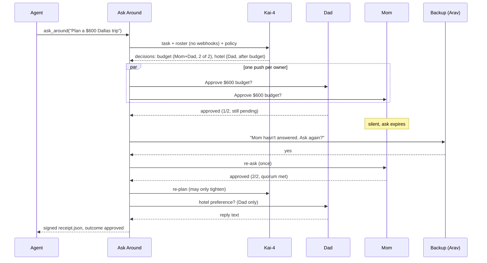

# Ask Around

**Governance for agents that ask people: who may answer, how many must agree, and what silence means.**

  

One tool call, `ask_around(task, roster, policy)`. An agent gets real humans to decide through [Notify](https://notify.belweave.ai). Each question goes only to its owner, quorum and veto are enforced, and silence is never a yes.

## The 10-second story

An agent asks the family: **"Spend $600 on a Dallas trip?"**

| | Plain Notify | Ask Around |
|---|---|---|
| Who can approve | Whoever taps first | Mom **and** Dad, each asked on their own service |
| One "no" | Ignored if someone else tapped yes first | Vetoes the decision immediately |
| Mom never answers | The ask expires | Her backup is asked "Mom hasn't answered. Ask again?". Mom is re-asked. If that fails, the decision is **blocked**, never approved |
| Afterwards | Nothing | A receipt of every ask, answer and event ID, signed if you set a key |

## The gap, in Notify's own words

> Family: "Any accepted family member … may respond, and the first valid server-confirmed answer settles the prompt."

> `deviceIds` only reach your own devices: "A foreign or unknown selection returns `400 Invalid device selection`." Family accounts get `403` on device groups.

That is right for "is the stove off?". It is wrong for money.

| | Notify today | Ask Around |
|---|---|---|
| **Who answers** | Anyone who can see the prompt | The owner only, routed per person (one webhook service each, optional `device_id`) |
| **How many agree** | First valid answer settles it | N-of-M quorum, and any deny vetoes |
| **Silence** | Expires | Never consent: escalate to a backup, then block |

## The flow



Details are in [docs/how-it-works.md](docs/how-it-works.md).

## Real output (`--dry-run`)

`--dry-run` fakes Notify in-process. One person goes silent on their first ask. With no `BELWEAVE_API_KEY` it uses a built-in offline plan, so the three decisions below are that fixed plan, not a Kai-4 plan.

```text
                   Ask Around · Plan a $600 weekend trip to Dallas for a concert
┏━━━━━━━━━━━━━━━━━━━━━━━━━━━━━━━━━━━━━━━━━━━━━━━━━━━━━━━━━━━┳━━━━━━━━━━━━━━┳━━━━━━━┳━━━━━━━━┳━━━━━━┓
┃ Decision                                                  ┃ Owners       ┃ Votes ┃ Status ┃ Left ┃
┡━━━━━━━━━━━━━━━━━━━━━━━━━━━━━━━━━━━━━━━━━━━━━━━━━━━━━━━━━━━╇━━━━━━━━━━━━━━╇━━━━━━━╇━━━━━━━━╇━━━━━━┩
│ d1 Approve going ahead with: Plan a $600 weekend trip to  │ Dad ✔, Mom ✔ │ 2/2   │ passed │      │
│ Dallas                                                    │              │       │        │      │
│ d2 Approve the transport and timing for this plan? (after │ Mom ✔        │ 1/1   │ passed │      │
│ d1)                                                       │              │       │        │      │
│ d3 Approve booking everything now? (after d1, d2)         │ Dad ✔, Mom ✔ │ 2/1   │ passed │      │
└───────────────────────────────────────────────────────────┴──────────────┴───────┴────────┴──────┘
 passed   d1: Approve going ahead with: Plan a $600 weekend trip to Dallas for a concert?
 passed   d2: Approve the transport and timing for this plan?
 passed   d3: Approve booking everything now?
Receipt written to receipt.json (7 asks)
```

The receipt shows Mom's silence and the escalation (trimmed; the eventIds are the fake transport's):

```json
{ "task": "Plan a $600 weekend trip to Dallas for a concert", "outcome": "approved",
  "decisions": [{ "id": "d1", "owners": ["dad", "mom"], "quorum": 2, "outcome": "passed",
                  "votes": { "dad": "yes", "mom": "yes" } }],
  "asks": [
    { "decision": "d1", "person": "dad",  "kind": "primary",    "eventId": "evt_1", "status": "approved" },
    { "decision": "d1", "person": "mom",  "kind": "primary",    "eventId": "evt_2", "status": "expired" },
    { "decision": "d1", "person": "arav", "kind": "escalation", "eventId": "evt_3", "status": "yes",
      "prompt": "Mom hasn't answered: Approve going ahead with: …? Ask again?" },
    { "decision": "d1", "person": "mom",  "kind": "reask",      "eventId": "evt_4", "status": "approved" } ] }
```

## Quickstart

```bash
python3 -m venv .venv && . .venv/bin/activate && pip install -e ".[mcp]"
cp roster.example.yaml roster.yaml     # one Notify webhook service per person; git-ignored
export BELWEAVE_API_KEY=...
python -m askaround "Plan a \$600 weekend trip to Dallas for a concert" --roster roster.yaml --policy policy.yaml --expires 30
```

Add `--dry-run` to rehearse without phones. Exit codes: `0` approved, `1` rejected or blocked, `2` error.

## MCP

`ask_around(task, roster_path, policy_path)` over stdio returns the receipt as JSON. Only `outcome == "approved"` means go. Full schema and an example call: [docs/mcp.md](docs/mcp.md).

```bash
claude mcp add --env BELWEAVE_API_KEY="$BELWEAVE_API_KEY" ask-around -- \
  /abs/path/ask-around/.venv/bin/python -m askaround.mcp_server
```

```json
{ "mcpServers": { "ask-around": { "command": "/abs/path/ask-around/.venv/bin/python",
                                  "args": ["-m", "askaround.mcp_server"],
                                  "env": { "BELWEAVE_API_KEY": "${BELWEAVE_API_KEY:-}" } } } }
```

## Safety guarantees

- **A timeout is never approval.** Only a server-confirmed `approved` or `yes` counts. `expired`, `canceled`, `denied`, `no`, network errors, malformed responses and unknown statuses are all NO.
- **Fails closed.** Policy rules naming an unknown owner are an error, and so is a policy path that doesn't exist.
- **Re-plans can only tighten.** They can't lower quorum, remove owners or dependencies, or turn an approval into free text. Only informational `text` decisions can be dropped.
- **No dangling prompts.** When a decision settles, its other pending asks are cancelled, including one still being delivered.
- **Secrets stay local.** Keys come from the environment. Webhook URLs live only in the git-ignored `roster.yaml`, and are never sent to the planner or logged.
- **Timeouts are bounded.** `--expires` and `max_expires_s` clamp every decision, so silence escalates in seconds.

## Docs

[How it works](docs/how-it-works.md) · [Policy and roster reference](docs/policy.md) · [MCP](docs/mcp.md) · [Receipts and signing](docs/receipts.md) · [Notify integration](docs/notify-integration.md)

## Tests

`pytest -q` runs 122 tests against a fake Notify transport built from the documented endpoints. They cover quorum, veto, escalation, dependencies, re-plan limits, Live Activity failures, signing and tamper detection, a real MCP stdio round trip, and 40 random status sequences that must never produce a false approval. The suite does not exercise live Notify or Kai-4.

## Honest notes

- Multi-approver flows already exist in other tools (HumanWire, Quorum, Copilot Studio multistage approvals). Ask Around brings them to Notify as one tool call any MCP-capable agent can use.
- Strict "only the owner sees it" needs per-person services. On a shared service the wrong-person guard ignores bad answers, but others can still see the prompt.
- Live Activity is best effort and not guaranteed instant. The planner is an LLM: expression rules like `money > 200` rely on Kai-4, while plain-keyword rules are also enforced in code.
- Once quorum is met, the other asks are cancelled, so a later deny in a 1-of-2 decision is never seen. Use quorum = all owners when everyone must agree.

Built at **Notify Weekend 01** with [Notify](https://notify.belweave.ai) for delivery and Belweave **Kai-4** for planning. Thanks to both.
